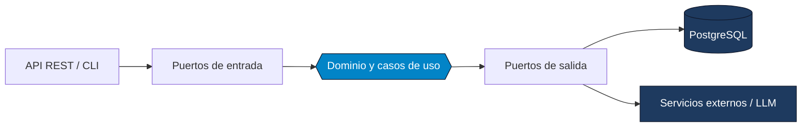

  

  

  
  
  
  
  

---

### Perfil

Desarrollador Backend Junior graduado de Campuslands. Me enfoco en el diseño e implementación de sistemas empresariales desacoplados, microservicios y APIs RESTful de alto rendimiento, con especial atención a la arquitectura y la calidad del código.

| Área | Enfoque |
| :--- | :--- |
| **Java** | Java 21, Spring Boot, Maven, JDBC, Hibernate/JPA, programación concurrente multihilo |
| **Python** | FastAPI, Pydantic v2, LangChain, Pytest |
| **Arquitectura** | Arquitectura Hexagonal (Puertos y Adaptadores), DDD, SOLID, patrones Observer, Strategy, Factory y Singleton |
| **Datos** | PostgreSQL 16, MySQL, modelado relacional, consultas complejas, persistencia en JSON |
| **DevOps** | Docker, Docker Compose, despliegue en servidores Linux |
| **Metodología** | Scrum, Git Flow, Conventional Commits |

---

### Stack tecnológico

  

---

### Enfoque arquitectónico

Mis proyectos empresariales siguen Arquitectura Hexagonal: el dominio no depende de frameworks ni de infraestructura.

---

### Proyectos destacados

| Proyecto | Arquitectura y backend | Stack | Repositorio |
| :--- | :--- | :--- | :---: |
| **Plataforma de Renta de Maquinaria** | Sistema empresarial con Arquitectura Hexagonal y DDD. Control transaccional de disponibilidad, cálculo de depósitos y liquidación de averías. | Java 21, Spring Boot, PostgreSQL, Docker, Maven | [Ver repo](https://github.com/Samuelgelvez20/Plataforma-de-Renta-de-Herramientas-de-Construccion) |
| **SICA, Control de Acceso Perimetral** | Sistema modular de seguridad perimetral con Vertical Slices, JDBC puro, persistencia en PostgreSQL y patrón Observer. | Java 21, Hexagonal, PostgreSQL, Docker, JDBC | [Ver repo](https://github.com/Samuelgelvez20/SICA-ZonaAcme) |
| **Tribunal Bimmer, API Analítica** | API RESTful con validación estricta en tiempo de ejecución, orquestación de modelos LLM con LangChain y pruebas con Pytest. | Python 3.11, FastAPI, Pydantic, LangChain, Pytest, Docker | [Ver repo](https://github.com/Samuelgelvez20/Tribunal-Bimmer) |
| **F1 Simulator, Motor Concurrente** | Simulador de clasificación con procesamiento paralelo (un hilo por piloto), motor de telemetría y persistencia relacional. | Java, ExecutorService, PostgreSQL, Maven | [Ver repo](https://github.com/Samuelgelvez20/f1-simulator) |
| **CVLens-AI, Motor de Evaluación** | Evaluación semántica y compatibilidad ATS de documentos PDF con LLMs, Pydantic y PostgreSQL en Docker. | Python, LangChain, Google Gemini, Docker, PostgreSQL | [Ver repo](https://github.com/Samuelgelvez20/CVLens-AI) |

---

### Actividad y métricas

  
  

  

  

  <picture>
    <source media="(prefers-color-scheme: dark)" srcset="https://raw.githubusercontent.com/Samuelgelvez20/Samuelgelvez20/output/github-snake-dark.svg" />
    <source media="(prefers-color-scheme: light)" srcset="https://raw.githubusercontent.com/Samuelgelvez20/Samuelgelvez20/output/github-snake.svg" />
    
  </picture>

---

### Contacto

Abierto a oportunidades como desarrollador backend. La forma más rápida de contactarme es por [LinkedIn](https://linkedin.com/in/samuelgelvezdev) o por [correo](mailto:samueldavidgelvezr@gmail.com).

  

