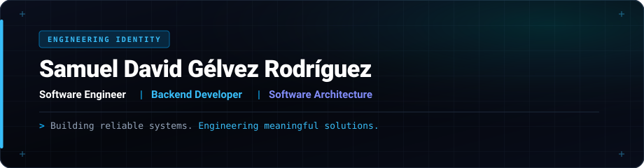
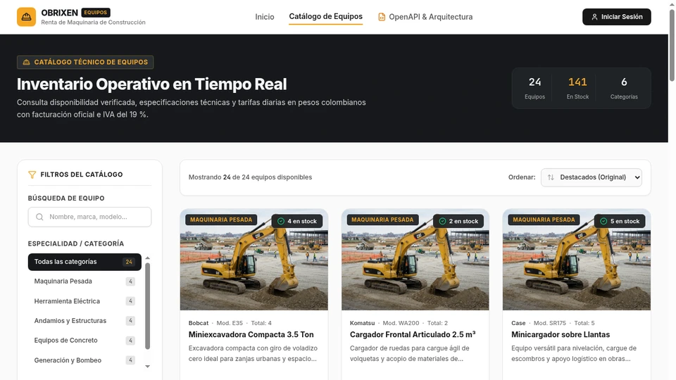
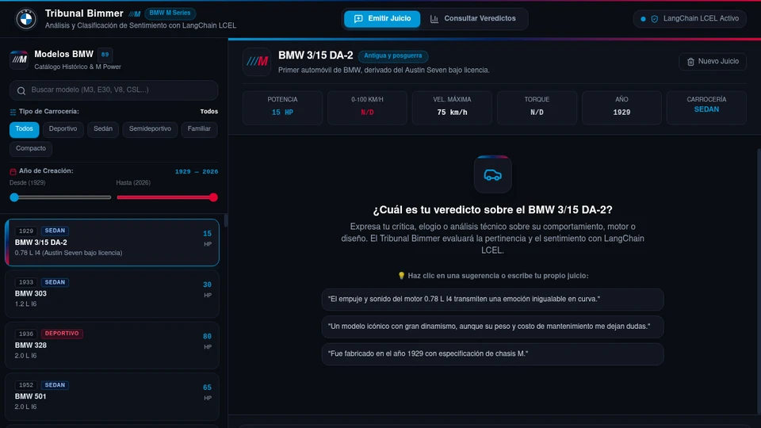
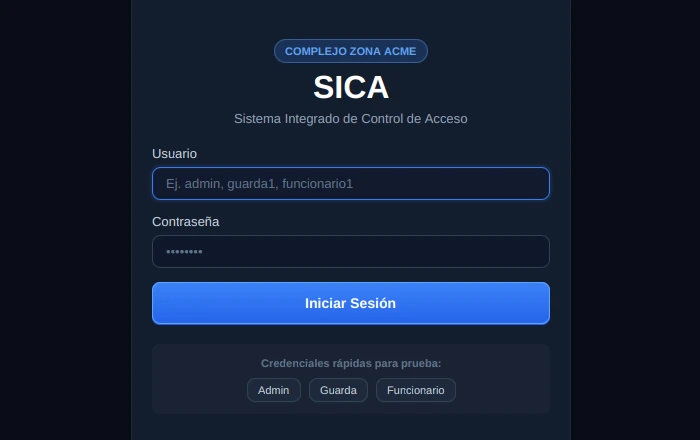
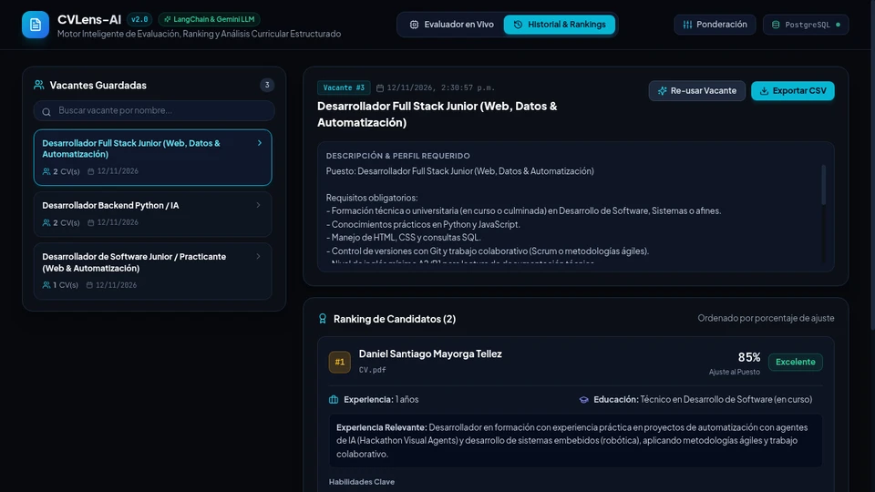
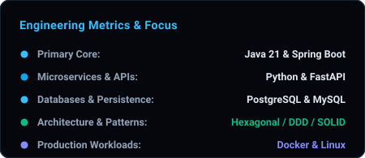
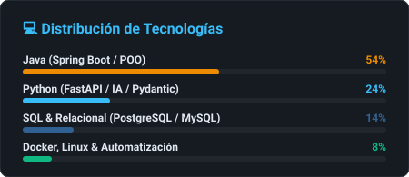

<div align="center">
  
</div>

<p align="center">
  
</p>

<p align="center">
  <a href="https://github.com/Samuelgelvez20"></a>
  <a href="https://linkedin.com/in/samuelgelvezdev"></a>
  <a href="mailto:samueldavidgelvezr@gmail.com"></a>
  <a href="https://samuelgelvez20.github.io/PORTAFOLIO/"></a>
</p>

---

### About Me

I am a **Software Engineer** focused on backend development, system architecture, and building reliable, maintainable software systems. My engineering foundation is centered on decoupling business logic from infrastructure, designing robust RESTful APIs, and implementing clean data persistence models.

I regularly work with **Java (Spring Boot)** and **Python (FastAPI)**, applying **Domain-Driven Design (DDD)**, **Hexagonal Architecture**, and **SOLID** principles. In addition to core backend services, I design and integrate AI evaluation workflows and containerized environments with **Docker**, ensuring reproducible execution and measurable software quality.

| `DDD / Hex` <br> <sub>ARCHITECTURE</sub> | `Zero-Coupling` <br> <sub>DOMAIN CORE</sub> | `Contract-First` <br> <sub>API DESIGN</sub> | `LCEL / LLM` <br> <sub>AI PIPELINES</sub> |
| :---: | :---: | :---: | :---: |

---

### Engineering Focus

| Focus Area | Architecture & Technical Capabilities |
| :--- | :--- |
| **Backend Architecture** | Hexagonal Architecture (Ports and Adapters), Domain-Driven Design (DDD), and strict boundary isolation. |
| **API Engineering** | Contract-first RESTful API design, strict runtime data validation, and asynchronous background processing. |
| **Data & Persistence** | Relational schema design with PostgreSQL and MySQL, transactional integrity, and Redis caching. |
| **AI Integration** | Semantic evaluation pipelines, prompt engineering with LCEL, and deterministic structured LLM outputs. |
| **Infrastructure & Quality** | Container orchestration with Docker Compose, automated testing suites, and Linux environments. |

---

### Tech Stack

#### Languages
<p align="left">
  
</p>

#### Backend Frameworks & Runtimes
<p align="left">
  
</p>

#### Databases & Infrastructure
<p align="left">
  
</p>

#### Client-Side & Ecosystem
<p align="left">
  
</p>

---

### Featured Projects

#### 01. Plataforma de Renta de Maquinaria y Construcción
**Enterprise Machinery Rental Platform & Decoupled Domain Architecture**

Enterprise web solution for managing heavy machinery rentals, availability reservation tracking, and dynamic billing workflows. Designed under Hexagonal Architecture (Ports and Adapters) and Domain-Driven Design (DDD) to guarantee complete independence between business logic and database/framework drivers.

```text
// HEXAGONAL ARCHITECTURE SPECIFICATION
Architecture : Hexagonal Architecture (Ports & Adapters) with DDD Principles
Tech Stack   : Java 21, Spring Boot, PostgreSQL, Docker, Maven, SOLID
Core Focus   : Total core decoupling, transactional availability tracking, dynamic rate calculation
```

<p align="center">
  
</p>

- **Repository:** [Plataforma-de-Renta-de-Herramientas-de-Construccion on GitHub](https://github.com/Samuelgelvez20/Plataforma-de-Renta-de-Herramientas-de-Construccion)

<br />

#### 02. Tribunal Bimmer
**Automotive Sentiment Analysis & Runtime Intelligence**

High-performance RESTful API and analytical platform designed to classify, process, and evaluate BMW automotive community feedback. Features strict data contracts validated at runtime with Pydantic v2, and real-time semantic analysis pipelines powered by LangChain and LLM models.

```text
// RUNTIME INTELLIGENCE SPECIFICATION
Architecture : Decoupled API Service with Deterministic Semantic Inference
Tech Stack   : Python 3.11, FastAPI, LangChain (LCEL), Pydantic v2, Pytest, Docker, SOLID
Core Focus   : Strict runtime data contracts, few-shot prompt engineering, prompt injection defense
```

<p align="center">
  
</p>

- **Repository:** [Tribunal-Bimmer on GitHub](https://github.com/Samuelgelvez20/Tribunal-Bimmer)

<br />

#### 03. SICA — Sistema Integrado de Control de Acceso (Zona Acme)
**Enterprise Perimeter Security & Access Management System**

Enterprise perimeter security application designed to digitize physical access control across a corporate complex with 30+ tenant companies. Built with a decoupled Java 21 architecture organized into Vertical Slices, integrating the Observer pattern for real-time security alerts and optimized JDBC transactions on Dockerized PostgreSQL.

```text
// ACCESS CONTROL SPECIFICATION
Architecture : Vertical Slice Architecture with Hexagonal Ports & Adapters
Tech Stack   : Java 21, PostgreSQL, Docker, JDBC, Maven
Core Focus   : Multi-tenant perimeter access (30+ corporate tenants), Observer pattern, audit logs
```

<p align="center">
  
</p>

- **Repository:** [SICA-ZonaAcme on GitHub](https://github.com/Samuelgelvez20/SICA-ZonaAcme)

<br />

#### 04. CVLens-AI
**Resume Intelligence & ATS Evaluation Engine with LLMs**

Intelligent backend engine for concurrent parsing and ATS evaluation of PDF resumes using LangChain and Google Gemini. Enforces structured output schemas with Pydantic v2 under a weighted algorithmic scoring model (experience 40%, skills 35%, education 15%, coherence 10%) with rankings persisted in PostgreSQL and containerized deployment.

```text
// AI EVALUATION ENGINE SPECIFICATION
Architecture : Asynchronous Document Intelligence & Scoring Engine
Tech Stack   : Python, FastAPI, LangChain, Google Gemini, Pydantic v2, PostgreSQL, Docker
Core Focus   : Concurrent PDF parsing, weighted algorithmic scoring, structured LLM validation
```

<p align="center">
  
</p>

- **Repository:** [CVLens-AI on GitHub](https://github.com/Samuelgelvez20/CVLens-AI)

---

### Additional Production Repositories

| Repository | Focus & Architecture | Stack | Link |
| :--- | :--- | :--- | :---: |
| **Campuslands OpsCenter** | High-contention transactional API for room booking and automated Gemini AI triaging engine with space lockouts. | Python 3.12, FastAPI, PostgreSQL, SQLAlchemy, Docker | [View Repo](https://github.com/Samuelgelvez20/Campuslands-OpsCenter-) |
| **F1 Simulator** | Parallel multithreaded simulation engine (dedicated thread per car via ExecutorService) with weather penalties and PostgreSQL persistence. | Java 21, Multithreading, ExecutorService, PostgreSQL, JDBC | [View Repo](https://github.com/Samuelgelvez20/f1-simulator) |

---

### GitHub Activity

<p align="center">
  
  
</p>

<p align="center">
  
</p>

---

### Connect

Open to software engineering and backend architecture opportunities. Feel free to reach out through any of the following channels:

- **GitHub:** [Samuelgelvez20](https://github.com/Samuelgelvez20)
- **LinkedIn:** [in/samuelgelvezdev](https://linkedin.com/in/samuelgelvezdev)
- **Email:** [samueldavidgelvezr@gmail.com](mailto:samueldavidgelvezr@gmail.com)
- **Portfolio:** [samuelgelvez20.github.io/PORTAFOLIO](https://samuelgelvez20.github.io/PORTAFOLIO/)

<br />

<p align="center">
  <em>Building reliable systems through architectural discipline, precision, and continuous learning.</em>
</p>
