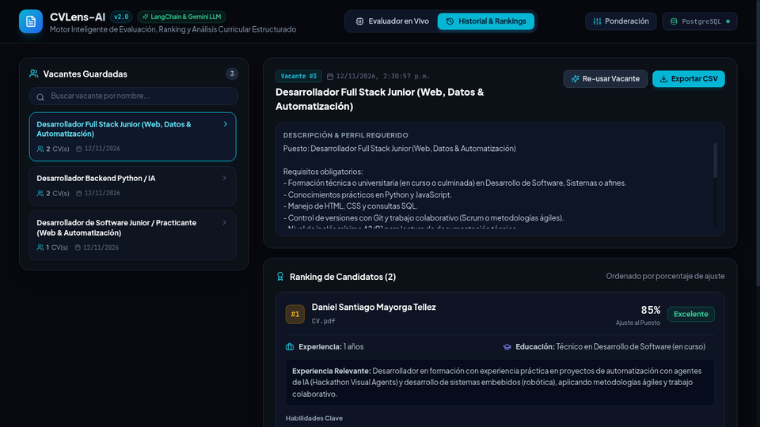
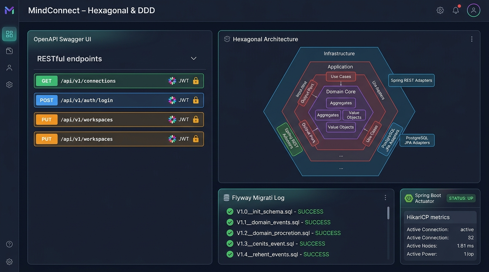
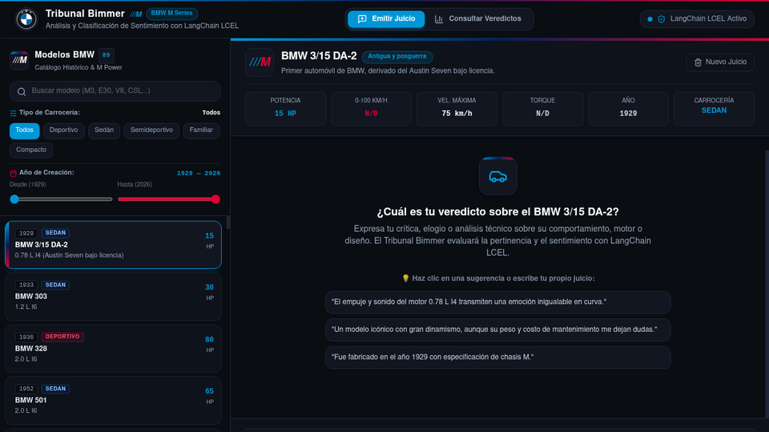

<div align="center">
  
</div>

<p align="center">
  
</p>

<p align="center">
  <a href="https://github.com/Samuelgelvez20"></a>
  <a href="https://linkedin.com/in/samuelgelvezdev"></a>
  <a href="mailto:samueldavidgelvezr@gmail.com"></a>
  <a href="https://samuelgelvez20.github.io/PORTAFOLIO/"></a>
</p>

---

### About Me

I am a Software Engineer focused on backend development, system architecture, and building reliable, maintainable software systems. My engineering foundation is centered on decoupling business logic from infrastructure, designing robust RESTful APIs, and implementing clean data persistence models.

I regularly work with Java (Spring Boot) and Python (FastAPI), applying Domain-Driven Design (DDD), Hexagonal Architecture, and SOLID principles. In addition to core backend services, I design and integrate AI evaluation workflows and containerized environments with Docker, ensuring reproducible execution and measurable software quality.

---

### Engineering Focus

- **Backend Architecture:** Hexagonal Architecture (Ports and Adapters), Domain-Driven Design (DDD), and boundary isolation.
- **API Engineering:** Contract-first RESTful API design, strict runtime data validation, and asynchronous processing.
- **Data & Persistence:** Relational schema design with PostgreSQL and MySQL, transactional integrity, and Redis caching.
- **AI Integration:** Semantic evaluation pipelines, prompt engineering with LCEL, and structured LLM outputs.
- **Infrastructure & Quality:** Container orchestration with Docker Compose, automated testing suites, and Linux environments.

---

### Tech Stack

#### Languages
<p align="left">
  
</p>

#### Backend
<p align="left">
  
</p>

#### Databases & Infrastructure
<p align="left">
  
</p>

#### Frontend
<p align="left">
  
</p>

---

### Featured Projects

#### 1. Evaluador-Tecnico
**AI-Assisted Candidate Evaluation & Backend Architecture**

A structured technical evaluation platform designed to assess engineering candidates through automated workflows, code execution sandboxing, and AI-assisted scoring pipelines.

```text
Architecture : Microservices / Modular Backend with Asynchronous Task Queues
Tech Stack   : Python, FastAPI, PostgreSQL, Redis, Docker, LLM Integrations
Core Focus   : Strict schema validation, background job processing, reproducible candidate metrics
```

<p align="center">
  
</p>

- Repository: [Evaluador-Tecnico on GitHub](https://github.com/Cristixn04/Evaluador-Tecnico)
- Associated Engine: [CVLens-AI Evaluation Engine](https://github.com/Samuelgelvez20/CVLens-AI)

<br />

#### 2. MindConnect DDD
**Domain-Driven Design Enterprise Platform**

An enterprise software architecture project centered on Domain-Driven Design (DDD) and Hexagonal Architecture principles. It enforces strict boundary separation between ubiquitous domain language, application use cases, and infrastructure adapters.

```text
Architecture : Domain-Driven Design (DDD), Hexagonal Architecture (Ports & Adapters)
Tech Stack   : Java 21, Spring Boot, PostgreSQL, Docker, Maven, Spring Security
Core Focus   : Entity aggregates, value objects, transactional domain events, infrastructure decoupling
```

<p align="center">
  
</p>

- Repository: [mindconnect-ddd](https://github.com/Samuelgelvez20/mindconnect-ddd) *(Verified local architectural codebase)*

<br />

#### 3. Tribunal Bimmer
**Automotive Sentiment Analysis & Runtime Intelligence**

An analytical platform and RESTful service designed to process, classify, and evaluate vehicle perception data for BMW automotive models with high determinism.

```text
Architecture : Decoupled API Service with Deterministic Semantic Inference
Tech Stack   : Python 3.11, FastAPI, LangChain (LCEL), Pydantic v2, Pytest, React, Tailwind CSS
Core Focus   : Few-shot prompt engineering, prompt-injection defense, automated test suites
```

<p align="center">
  
</p>

- Repository: [Tribunal-Bimmer on GitHub](https://github.com/Samuelgelvez20/Tribunal-Bimmer)

---

### GitHub Activity

<p align="center">
  
  
</p>

<p align="center">
  
</p>

---

### Connect

Open to software engineering and backend development opportunities. Feel free to reach out through any of the following channels:

- GitHub: [Samuelgelvez20](https://github.com/Samuelgelvez20)
- LinkedIn: [in/samuelgelvezdev](https://linkedin.com/in/samuelgelvezdev)
- Email: [samueldavidgelvezr@gmail.com](mailto:samueldavidgelvezr@gmail.com)
- Portfolio: [samuelgelvez20.github.io/PORTAFOLIO](https://samuelgelvez20.github.io/PORTAFOLIO/)

<br />

<p align="center">
  <em>Building reliable systems through architectural discipline, precision, and continuous learning.</em>
</p>
